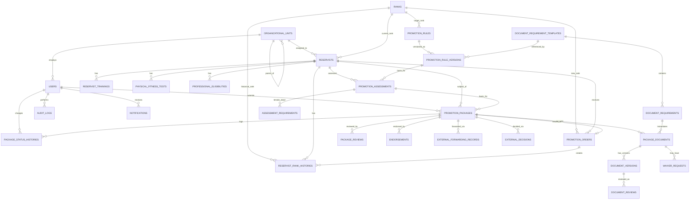
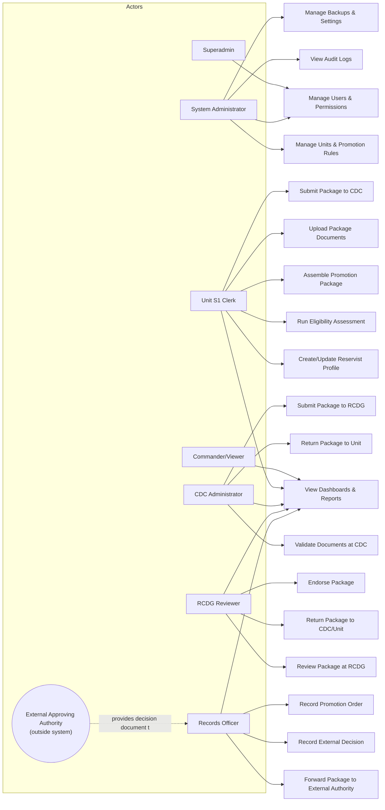

# PromoTrack AFP-RF — Phase 1 Design (CodeIgniter 4)

> Framework: **CodeIgniter 4** (Shield for auth). No PHP source code, controllers, or views are included in this
> phase. This document is the architecture/design baseline that all later implementation phases must follow.
>
> Any figure, rule, deadline, authority, or format that is **not** explicitly confirmed by an official AFP /
> Philippine Army issuance is flagged inline as:
> **REQUIRES OFFICIAL AFP/PHILIPPINE ARMY VALIDATION**

---

## 1. Finalized System Scope

PromoTrack AFP-RF is an internal records/workflow system used by Philippine Army Reserve Force unit staff to:

1. Maintain reservist profiles, rank history, training, physical fitness, and professional-eligibility records.
2. Evaluate promotion eligibility against **versioned** promotion rules (time-in-grade, MLES, training,
   documentary prerequisites) and produce an explainable, auditable assessment.
3. Assemble, validate, and route a **Promotion Package** through a controlled workflow:
   `Unit S1 Clerk → CDC → RCDG → External Approving Authority (outside the system) → Records Officer`.
4. Track document completeness, versioning, verification, rejection, and waivers for every package.
5. Record endorsements, external forwarding, external decisions, and promotion orders as they are officially
   received (the system does **not** simulate or auto-approve external command decisions).
6. Provide role- and unit-scoped dashboards, PDF/Excel reports, notifications, and a tamper-resistant audit log.

**Out of scope for the system (external actors, not system users):**
- Final approving military authorities (e.g., higher headquarters boards/commanders) — their decisions are
  *recorded* by the Records Officer, not *rendered* inside the system.
- Actual military personnel/HR systems of record (PromoTrack is a promotion-tracking tool, not the AFP's
  official personnel database).

---

## 2. CodeIgniter 4 Module Architecture

| Module | Primary Controllers | Primary Services | Primary Models |
|---|---|---|---|
| Auth & Identity | `Auth/*` (Shield) | `AccessControlService` | Shield-managed (`auth_*`), `UserModel` |
| Org & Reference Data | `Admin/UnitsController`, `Admin/RanksController` | — | `UnitModel`, `RankModel`, `EducationTrackModel`, `TrainingTypeModel` |
| Reservist Records | `ReservistsController` | `AccessControlService` | `ReservistModel`, `RankHistoryModel`, `ReservistTrainingModel`, `PhysicalFitnessTestModel`, `ProfessionalEligibilityModel` |
| Promotion Rules | `PromotionRulesController` | `PromotionRuleService` | `PromotionRuleModel`, `PromotionRuleVersionModel` |
| Eligibility Assessment | `PromotionAssessmentsController` | `EligibilityService` | `PromotionAssessmentModel`, `AssessmentRequirementModel` |
| Package & Documents | `PromotionPackagesController`, `PackageDocumentsController` | `PackageWorkflowService`, `DocumentValidationService`, `FileStorageService` | `PromotionPackageModel`, `PackageStatusHistoryModel`, `PackageDocumentModel`, `DocumentVersionModel`, `DocumentReviewModel`, `WaiverRequestModel` |
| CDC Validation | `CDC/ValidationController` | `PackageWorkflowService`, `DocumentValidationService` | `PackageReviewModel` |
| RCDG Review | `RCDG/ReviewController` | `PackageWorkflowService` | `PackageReviewModel`, `EndorsementModel` |
| External Forwarding & Decisions | `Records/ForwardingController`, `Records/DecisionsController` | `PackageWorkflowService` | `ExternalForwardingModel`, `ExternalDecisionModel` |
| Promotion Orders | `PromotionOrdersController` | `PackageWorkflowService` | `PromotionOrderModel`, `RankHistoryModel` |
| Reports & Dashboards | `ReportsController`, `Commander/DashboardController` | `ReportService` | read-only aggregation queries |
| Notifications | `Api/NotificationsController` | `NotificationService` | `NotificationModel` |
| Audit & Security | `AuditLogsController` | `AuditLogService` | `AuditLogModel` |
| Settings & Backups | `SettingsController` | `BackupService` | `SystemSettingModel` |

---

## 3. User Role & Permission Matrix

### 3.1 Shield Groups

`superadmin`, `system_administrator`, `unit_s1_clerk`, `cdc_administrator`, `rcdg_reviewer`,
`commander_viewer`, `records_officer`

### 3.2 Permission Matrix

`X` = granted by default group-permission assignment (Shield seed). `superadmin` implicitly has all permissions
and is omitted as a column (always full `X`).

| Permission | system_administrator | unit_s1_clerk | cdc_administrator | rcdg_reviewer | commander_viewer | records_officer |
|---|---|---|---|---|---|---|
| users.manage | X | | | | | |
| units.manage | X | | | | | |
| rules.manage | X | | | | | |
| reservists.create | | X | | | | |
| reservists.view | X | X (own unit) | X (own unit, submitted pkgs) | X (own unit, submitted pkgs) | X (scoped) | X (scoped) |
| reservists.update | | X (own unit) | | | | |
| assessments.compute | | X | | | | |
| assessments.verify | | | X | | | |
| packages.create | | X | | | | |
| packages.submit_to_cdc | | X | | | | |
| packages.validate_at_cdc | | | X | | | |
| packages.submit_to_rcdg | | | X | | | |
| packages.review_at_rcdg | | | | X | | |
| packages.return | | | X | X | | |
| packages.endorse | | | | X | | |
| documents.upload | | X | | | | |
| documents.verify | | | X | X | | |
| documents.reject | | | X | X | | |
| waivers.approve | | | X | X | | |
| forwarding.record | | | | | | X |
| external_decisions.record | | | | | | X |
| promotion_orders.record | | | | | | X |
| reports.view | X | X (own unit) | X (own scope) | X (own scope) | X | X |
| reports.generate | X | X (own unit) | X (own scope) | X (own scope) | X | X |
| audit_logs.view | X | | | | | |
| settings.manage | X | | | | | |
| backups.manage | X | | | | | |

> `commander_viewer` is strictly read-only across dashboards/reports; it holds no `.create`/`.update`/`.record`
> permissions.

All checks above are enforced redundantly at: Shield permission → route filter → controller authorization call →
unit-ownership check → record-level ownership check (see §12 Security Checklist).

---

## 4. Workflow-State Transition Table

Base transitions are the ones specified in the master prompt; gaps required for a resubmission/closure loop are
added below and marked **(added for completeness)**. All transitions are enforced exclusively by
`Libraries/WorkflowStateMachine.php` + `Services/PackageWorkflowService.php` — no controller may set
`promotion_packages.status` directly.

| From Status | Allowed To | Triggered By (permission) | Required Artifact |
|---|---|---|---|
| draft | requirements_incomplete, ready_for_cdc_validation | unit_s1_clerk (`packages.create`) | completeness check result |
| requirements_incomplete | ready_for_cdc_validation | unit_s1_clerk (`packages.create`) | 100% required documents present |
| ready_for_cdc_validation | under_cdc_validation | cdc_administrator (`packages.validate_at_cdc`) | — |
| under_cdc_validation | returned_to_unit, cdc_validated | cdc_administrator (`packages.return` / `packages.validate_at_cdc`) | return requires remarks |
| returned_to_unit | ready_for_cdc_validation | unit_s1_clerk (`packages.submit_to_cdc`) | **(added)** resubmission after fix |
| cdc_validated | submitted_to_rcdg | cdc_administrator (`packages.submit_to_rcdg`) | — |
| submitted_to_rcdg | under_rcdg_review | rcdg_reviewer (`packages.review_at_rcdg`) | — |
| under_rcdg_review | returned_by_rcdg, rcdg_endorsed | rcdg_reviewer (`packages.return` / `packages.endorse`) | return requires remarks |
| returned_by_rcdg | resubmitted_to_rcdg | cdc_administrator or unit_s1_clerk (`packages.submit_to_rcdg`) | **(added)** fix + resubmit |
| resubmitted_to_rcdg | under_rcdg_review | rcdg_reviewer (`packages.review_at_rcdg`) | **(added)** |
| rcdg_endorsed | forwarded_to_external_authority | records_officer (`forwarding.record`) | endorsement record present |
| forwarded_to_external_authority | awaiting_external_decision | records_officer (`forwarding.record`) | forwarding record (date, authority, reference no.) |
| awaiting_external_decision | approved, disapproved, deferred | records_officer (`external_decisions.record`) | external decision record (received document) |
| deferred | awaiting_external_decision | records_officer (`external_decisions.record`) | **(added)** re-forwarded/decision received later |
| approved | promotion_order_recorded | records_officer (`promotion_orders.record`) | promotion order record |
| disapproved | closed | records_officer (`external_decisions.record`) | **(added)** terminal, no order |
| promotion_order_recorded | closed | records_officer (`promotion_orders.record`) | rank history updated in same transaction |
| closed | archived | system_administrator | **(added)** retention policy trigger |

**Non-status-machine notes:**
- `documents.reject` / `waivers.approve` act on `package_documents` / `waiver_requests` rows, not on package
  status directly; they can, however, be preconditions the state machine checks before allowing a transition
  (e.g., `under_cdc_validation → cdc_validated` requires no `pending`/`rejected` required documents unless
  waived).
- Every transition writes one `package_status_histories` row (`from_status`, `to_status`, `changed_by`,
  `remarks`, `changed_at`) and one `audit_logs` row, inside the same DB transaction as the status update.

---

## 5. Normalized Database Schema

All tables use `id BIGINT UNSIGNED AUTO_INCREMENT PRIMARY KEY`, InnoDB, `utf8mb4`, and
`created_at` / `updated_at` (`deleted_at` where soft-delete applies). FK columns are `BIGINT UNSIGNED`.

### 5.1 Organization & Identity

**organizational_units**
`id, parent_unit_id (FK self, nullable), unit_code (unique), unit_name, unit_type, is_active, created_at, updated_at`

**users** *(Shield core table, extended)*
`id, organizational_unit_id (FK), employee_number (unique, nullable), full_name, status ENUM('active','inactive','locked'), last_login_at, created_at, updated_at, deleted_at`

*Shield-managed tables (not redesigned, used as-is):* `auth_identities`, `auth_logins`, `auth_token_logins`,
`auth_remember_tokens`, `auth_groups_users`, `auth_permissions_users`, `auth_groups_permissions`,
`login_histories` (custom audit companion to Shield's login events).

### 5.2 Reference Data

**ranks**
`id, rank_code (unique), rank_name, rank_category ENUM('enlisted','officer'), hierarchy_order (unique int), REQUIRES OFFICIAL AFP/PHILIPPINE ARMY VALIDATION for full official list/order, is_active`

**education_tracks**
`id, track_code (unique), track_name, is_active`

**training_types**
`id, training_code (unique), training_name, is_mandatory, validity_period_months (nullable), REQUIRES OFFICIAL AFP/PHILIPPINE ARMY VALIDATION for mandatory-training list per rank`

### 5.3 Reservist Records

**reservists**
`id, organizational_unit_id (FK), reservist_number (unique), afpsn_or_service_number (unique, nullable), last_name, first_name, middle_name, suffix, birth_date, sex, current_rank_id (FK ranks), education_track_id (FK), date_of_enlistment, date_of_last_promotion, contact_number, address, status ENUM('active','inactive','separated','deceased'), created_at, updated_at, deleted_at`

**reservist_rank_histories**
`id, reservist_id (FK), rank_id (FK ranks), effective_date, promotion_order_id (FK promotion_orders, nullable), remarks, created_at`
Unique index: `(reservist_id, effective_date)`

**reservist_trainings**
`id, reservist_id (FK), training_type_id (FK), completion_date, expiry_date (nullable), certificate_reference, created_at, updated_at`

**physical_fitness_tests**
`id, reservist_id (FK), test_date, score, result ENUM('pass','fail'), REQUIRES OFFICIAL AFP/PHILIPPINE ARMY VALIDATION for scoring thresholds, created_at`

**professional_eligibilities**
`id, reservist_id (FK), eligibility_type, exam_date, rating (nullable), certificate_number, expiry_date (nullable), created_at, updated_at`

### 5.4 Promotion Rules (versioned)

**promotion_rules**
`id, target_rank_id (FK ranks), rule_code (unique), title, is_active, created_at, updated_at`

**promotion_rule_versions**
`id, promotion_rule_id (FK), version_number, effective_from, effective_to (nullable), min_time_in_grade_months REQUIRES OFFICIAL AFP/PHILIPPINE ARMY VALIDATION, mles_requirement_json REQUIRES OFFICIAL AFP/PHILIPPINE ARMY VALIDATION, required_training_ids_json, required_document_template_id (FK document_requirement_templates), notes, created_by (FK users), created_at`
Unique index: `(promotion_rule_id, version_number)`

### 5.5 Assessments

**promotion_assessments**
`id, reservist_id (FK), promotion_rule_version_id (FK), assessed_by (FK users), assessment_date, computed_time_in_grade_months, mles_qualified TINYINT, overall_result ENUM('eligible','not_eligible','conditionally_eligible'), snapshot_json (full explainable breakdown, immutable), created_at`

**assessment_requirements**
`id, promotion_assessment_id (FK), requirement_code, requirement_label, is_satisfied, evidence_reference, remarks, created_at`

### 5.6 Promotion Packages & Documents

**promotion_packages**
`id, reservist_id (FK), promotion_assessment_id (FK), organizational_unit_id (FK), package_number (unique), status ENUM(<19 workflow statuses>), current_holder_role, completeness_percentage DECIMAL(5,2), submitted_by (FK users), created_at, updated_at`
Unique index enforcing no duplicate active package: `(reservist_id)` filtered to non-terminal statuses (enforced at
service layer with a DB transaction + row lock, since MySQL cannot express a partial unique index directly —
implemented via a generated `is_open` boolean column + unique key `(reservist_id, is_open)`).

**package_status_histories**
`id, promotion_package_id (FK), from_status (nullable), to_status, changed_by (FK users), remarks, created_at`

**document_requirement_templates**
`id, promotion_rule_id (FK, nullable), template_name, version, is_active, created_at`

**document_requirements**
`id, document_requirement_template_id (FK), document_code, document_label, is_conditional, condition_expression (nullable), display_order`

**package_documents**
`id, promotion_package_id (FK), document_requirement_id (FK), status ENUM('pending','uploaded','verified','rejected','waived'), current_version_id (FK document_versions, nullable), created_at, updated_at`
Unique index: `(promotion_package_id, document_requirement_id)`

**document_versions**
`id, package_document_id (FK), version_number, stored_filename (random, non-guessable), original_filename, mime_type, file_size_bytes, sha256_checksum, storage_path (writable/uploads/... — never public), uploaded_by (FK users), uploaded_at`

**document_reviews**
`id, document_version_id (FK), reviewed_by (FK users), decision ENUM('verified','rejected'), remarks, reviewed_at`

**waiver_requests**
`id, package_document_id (FK), requested_by (FK users), justification, approved_by (FK users, nullable), decision ENUM('pending','approved','denied'), decided_at (nullable), created_at`

**package_reviews**
`id, promotion_package_id (FK), reviewer_id (FK users), review_stage ENUM('cdc','rcdg'), decision ENUM('validated','returned','endorsed'), remarks, created_at`

**endorsements**
`id, promotion_package_id (FK), endorsed_by (FK users), endorsement_reference_number, endorsement_date, remarks, created_at`

### 5.7 External Routing & Outcomes

**external_forwarding_records**
`id, promotion_package_id (FK), forwarded_by (FK users), external_authority_name, forwarding_reference_number, forwarded_date, remarks, created_at`

**external_decisions**
`id, promotion_package_id (FK), recorded_by (FK users), decision ENUM('approved','disapproved','deferred'), decision_reference_number, decision_date, deciding_authority_name, remarks, supporting_document_path (nullable), created_at`

**promotion_orders**
`id, promotion_package_id (FK), reservist_id (FK), order_number (unique), order_date, effective_date, new_rank_id (FK ranks), recorded_by (FK users), created_at`

### 5.8 System-wide

**notifications**
`id, user_id (FK), type, title, body, related_entity_type, related_entity_id, is_read, created_at`

**audit_logs**
`id, user_id (FK, nullable), action, entity_type, entity_id, old_values_json, new_values_json, ip_address, user_agent, created_at`
Append-only: no `updated_at`; DB user for the app has no `UPDATE`/`DELETE` grant on this table in production.

**report_templates**
`id, template_code (unique), title, output_format ENUM('pdf','xlsx'), definition_json, created_at, updated_at`

**system_settings**
`id, setting_key (unique), setting_value, is_encrypted, updated_by (FK users), updated_at`

---

## 6. CodeIgniter Migration Plan (ordered by FK dependency)

1. `organizational_units`
2. Shield install (`php spark shield:setup`) → generates `users`, `auth_identities`, `auth_logins`,
   `auth_token_logins`, `auth_remember_tokens`, `auth_groups_users`, `auth_permissions_users`,
   `auth_groups_permissions`
3. `AddOrganizationalUnitToUsers` (alter `users`)
4. `login_histories`
5. `ranks`
6. `education_tracks`
7. `training_types`
8. `reservists`
9. `reservist_rank_histories`
10. `reservist_trainings`
11. `physical_fitness_tests`
12. `professional_eligibilities`
13. `promotion_rules`
14. `document_requirement_templates`
15. `document_requirements`
16. `promotion_rule_versions`
17. `promotion_assessments`
18. `assessment_requirements`
19. `promotion_packages`
20. `package_status_histories`
21. `package_documents`
22. `document_versions`
23. `document_reviews`
24. `waiver_requests`
25. `package_reviews`
26. `endorsements`
27. `external_forwarding_records`
28. `external_decisions`
29. `promotion_orders`
30. `AddPromotionOrderFkToRankHistories` (alter `reservist_rank_histories`)
31. `notifications`
32. `audit_logs`
33. `report_templates`
34. `system_settings`

Run with `php spark migrate`; seed with `php spark db:seed InitialSeeder` (composite seeder calling
group/permission, admin, org-unit, rank, education-track, training-type, and status-reference seeders).

---

## 7. Mermaid ERD



---

## 8. Mermaid Use Case Diagram



---

## 9. CodeIgniter 4 Folder Structure

```
app/
├── Config/
│   ├── Routes.php
│   ├── Filters.php
│   ├── Validation.php
│   ├── Security.php
│   ├── Auth.php
│   ├── AuthGroups.php
│   ├── Session.php
│   ├── Database.php
│   ├── Services.php
│   └── Events.php
├── Controllers/
│   ├── Auth/
│   ├── Admin/
│   ├── UnitClerk/
│   ├── CDC/
│   ├── RCDG/
│   ├── Records/
│   ├── Commander/
│   ├── Api/
│   └── BaseController.php
├── Models/
├── Entities/
├── Services/
├── Libraries/
├── Filters/
├── Validation/
├── Database/
│   ├── Migrations/
│   └── Seeds/
├── Views/
│   ├── layouts/
│   ├── components/
│   ├── auth/
│   ├── dashboards/
│   ├── reservists/
│   ├── assessments/
│   ├── packages/
│   ├── documents/
│   ├── cdc/
│   ├── rcdg/
│   ├── endorsements/
│   ├── forwarding/
│   ├── promotion_orders/
│   ├── reports/
│   ├── audit_logs/
│   ├── users/
│   └── settings/
└── Language/
    └── en/
public/
├── assets/{css,js,images,vendor}
└── index.php
writable/
├── uploads/          (private; never linked from public/)
├── reports/
├── backups/
├── logs/
├── cache/
└── session/
tests/
├── unit/
├── feature/
├── database/
├── security/
└── support/
```

*(Matches the master-prompt structure exactly, plus `AuthGroups.php` — required by Shield to define the seven
custom groups/permissions.)*

---

## 10. Route-Group Plan

| Group Prefix | Filter(s) | Controllers |
|---|---|---|
| `/auth` | none (public) + `throttle` on login/reset | `Auth/*` (Shield) |
| `/admin` | `session`, `permission:users.manage` (per-route override for units/rules) | `Admin/*` |
| `/unit` | `session`, `permission:reservists.create`, `unit-access` | `UnitClerk/*` |
| `/cdc` | `session`, `permission:packages.validate_at_cdc`, `unit-access` | `CDC/*` |
| `/rcdg` | `session`, `permission:packages.review_at_rcdg` | `RCDG/*` |
| `/records` | `session`, `permission:external_decisions.record` | `Records/*` |
| `/commander` | `session`, `permission:reports.view` | `Commander/*` |
| `/reports` | `session`, `permission:reports.view` | `ReportsController` |
| `/audit-logs` | `session`, `permission:audit_logs.view` | `AuditLogsController` |
| `/settings` | `session`, `permission:settings.manage` | `SettingsController` |
| `/documents/download/(:num)` | `session`, `permission:reservists.view`, `unit-access` | `PackageDocumentsController::download` |
| `/api/*` | `session`, `account-status`, CSRF (for state-changing verbs) | `Api/*` |

Global filters (applied to every route via `Filters.php` `$globals`): `security-headers`, `request-audit`.
`account-status` filter blocks `inactive`/`locked` users even with a valid session.

---

## 11. Service-Layer Plan

| Service | Depends On | Key Methods |
|---|---|---|
| `EligibilityService` | `PromotionRuleService`, `DateDurationCalculator` | `assess(Reservist $reservist, PromotionRuleVersion $version): PromotionAssessment` |
| `PromotionRuleService` | — | `getActiveVersion(int $ruleId, ?string $asOfDate)`, `createVersion(array $data)` |
| `DocumentValidationService` | `FileStorageService` | `getRequirementChecklist(PromotionPackage $pkg)`, `computeCompleteness(PromotionPackage $pkg): float` |
| `PackageWorkflowService` | `WorkflowStateMachine`, `AuditLogService`, `NotificationService` | `transition(PromotionPackage $pkg, string $toStatus, User $actor, ?string $remarks)` |
| `FileStorageService` | `FileChecksum` | `store(UploadedFile $file, string $context): array`, `retrieve(int $versionId, User $actor)` |
| `AuditLogService` | — | `record(User $actor, string $action, string $entityType, int $entityId, array $old, array $new)` |
| `NotificationService` | — | `notify(int $userId, string $type, string $title, string $body)` |
| `ReportService` | `PdfGenerator`, `ExcelGenerator` | `generatePackageStatusReport(array $filters, string $format)` |
| `BackupService` | — | `createBackup()`, `verifyBackup(string $path)` |
| `AccessControlService` | Shield | `canAccessUnit(User $user, int $unitId): bool`, `canAccessPackage(User $user, PromotionPackage $pkg): bool` |

`PackageWorkflowService::transition()` is the **only** entry point allowed to change
`promotion_packages.status`; it wraps `WorkflowStateMachine::canTransition()`,
`DocumentValidationService` preconditions, the DB transaction, history insert, notification dispatch, and audit
logging in one call.

---

## 12. Security-Control Checklist

- [ ] CSRF protection enabled globally for POST/PUT/PATCH/DELETE
- [ ] Session: regenerate ID after login, `httponly`, `secure` (prod), `samesite = Strict`
- [ ] Login throttling + account lockout via Shield
- [ ] Password hashing via Shield (Argon2id/bcrypt per Shield defaults)
- [ ] Optional 2FA available for elevated roles (`superadmin`, `system_administrator`)
- [ ] Every protected controller method re-checks permission + unit-access + record-level ownership (no
      reliance on hidden UI)
- [ ] Uploaded documents stored under `writable/uploads/` (never under `public/`)
- [ ] Document downloads served only via authenticated/authorized controller streaming (`Content-Disposition`,
      no direct static URL)
- [ ] Filenames randomized on upload; original filename retained only as metadata
- [ ] MIME type + extension whitelist + file-size limit enforced server-side
- [ ] SHA-256 checksum computed and stored per document version
- [ ] Malware-scan integration point defined in `FileStorageService::store()` (pluggable hook)
- [ ] Prepared statements only (Query Builder / parameter binding — no raw string interpolation)
- [ ] Model `$allowedFields` restricts mass-assignment on every model
- [ ] Output escaped with `esc()` in all views by default
- [ ] Security headers: CSP, X-Frame-Options, X-Content-Type-Options, Referrer-Policy, Permissions-Policy
- [ ] HTTPS enforced in production (`app.baseURL` + redirect filter)
- [ ] `CI_ENVIRONMENT=production` with `display_errors` off and generic error pages
- [ ] `audit_logs` table is append-only at the DB-grant level (no UPDATE/DELETE for the app DB user)
- [ ] Sensitive settings (`system_settings.is_encrypted = 1`) encrypted at rest via CI4 Encryption service
- [ ] Backups encrypted; restoration procedure documented and tested
- [ ] No secrets, stack traces, reservist PII, or file paths written to logs
- [ ] Cross-unit and cross-role access explicitly tested (IDOR / privilege escalation test suite)

---

## 13. Development Roadmap (phase-ordered, no dates)

1. **Phase 1 — Design (this document):** scope, schema, roles, workflow, architecture. *(complete)*
2. **Phase 2 — Foundation:** Composer project bootstrap, `.env` config, Shield install/setup, base migrations
   for org units/users/reference data, `AuthGroups.php`, base filters, `BaseController`.
3. **Phase 3 — Reservist & Rules Core:** reservist CRUD, rank history, training/PFT/eligibility records,
   versioned promotion rules, `EligibilityService` + assessment snapshotting.
4. **Phase 4 — Package Workflow Core:** `WorkflowStateMachine`, `PackageWorkflowService`, package creation,
   document requirement templates, `FileStorageService`, document upload/verify/reject/waiver.
5. **Phase 5 — Stage Controllers:** CDC validation, RCDG review/endorsement, external forwarding, external
   decision recording, promotion order recording + rank-history update transaction.
6. **Phase 6 — Reporting & Dashboards:** `ReportService` (Dompdf/PhpSpreadsheet), role/unit-scoped dashboards,
   Chart.js widgets, DataTables server-side endpoints, notifications.
7. **Phase 7 — Testing & Hardening:** full PHPUnit suite (unit/feature/database/security), OWASP ZAP pass,
   JMeter/k6 load pass, security checklist sign-off.
8. **Phase 8 — Deployment Readiness:** production `.env` hardening, backup/restore drill, final documentation.

Each phase produces migrations, seeders, entities, models, services, controllers, validation, filters, routes,
views, JS, tests, and installation/testing notes for the module(s) it covers — per the "Required Development
Output" contract — before the next phase begins.

---

## 14. Values Requiring Official AFP / Philippine Army Validation

The following are **placeholders only** and must not be treated as authoritative until confirmed by an official
AFP/Philippine Army issuance. Each is marked in the schema/rules above and must be re-flagged wherever used in
later phases:

1. Official, complete, and correctly ordered list of enlisted/officer ranks and their hierarchy.
2. Minimum time-in-grade (in months/years) required per rank-to-rank promotion.
3. MLES (Mandatory/Minimum Length of Effective Service) qualification durations and computation rules per rank.
4. Mandatory training types/courses required per target rank, and their validity periods.
5. Physical Fitness Test passing score thresholds and retake rules.
6. Professional eligibility requirements (civil service, board exams, etc.) accepted per rank and their
   validity/expiry periods.
7. Complete, per-rank list of required promotion-package documents (and which are conditional/waivable).
8. Waiver authority — who may approve a waiver, for which document types, and under what conditions.
9. CDC and RCDG composition, exact validation criteria, and authority limits.
10. Names/titles/hierarchy of external approving authorities and the official forwarding channel/protocol.
11. Official processing-time deadlines/SLAs at each workflow stage (if any exist).
12. Official promotion order numbering scheme and required order document format.
13. Official report layouts/letterheads required for PDF/Excel exports submitted to higher headquarters.
14. Retention period before a `closed` package is eligible to become `archived`.

---

*End of Phase 1 deliverable. No PHP source code, controllers, or views were generated in this phase.*
